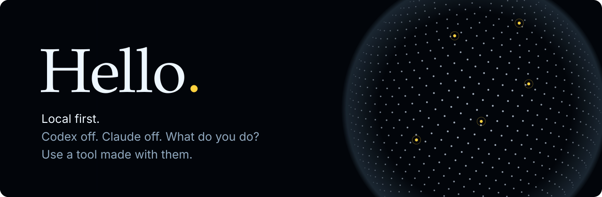
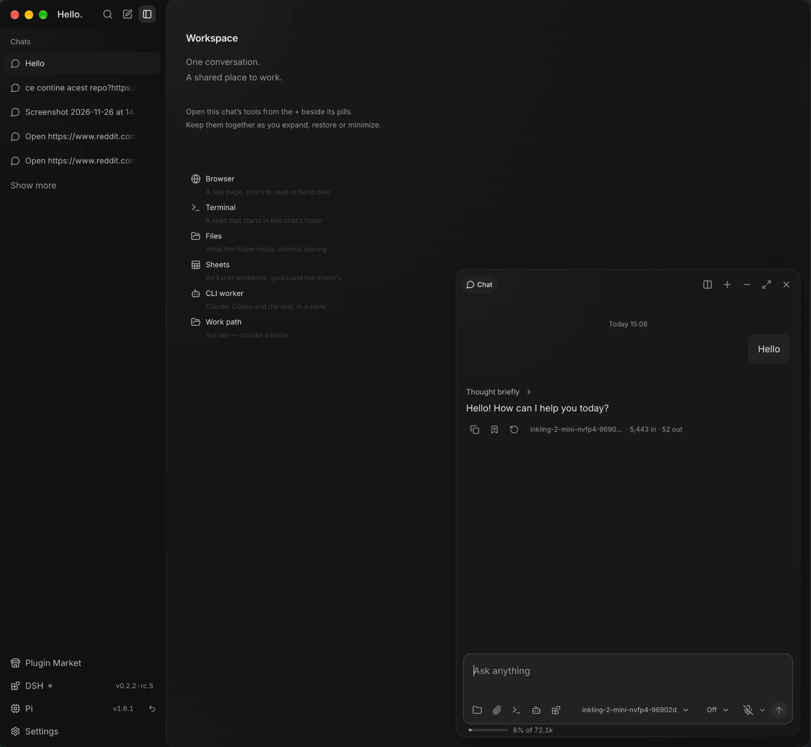

<p align="center">
  <a href="https://gelubodrug.github.io/Hello./"></a>
</p>

# Hello.

**Hello! Glad to meet you.**

Hello. is a local-first workspace for AI models on your Mac: one conversation,
and beside it a shared place to work — a real browser, terminals, files,
spreadsheets and the CLI agents you already have.

It is made to be a pleasure to use, not only useful. How it looks, how it moves
and what it does when you close, hide or stop something were decided first, and
the features were built to fit.

> Codex off. Claude off. What do you do?
> You use a tool made with them.

The idea: the experience you are used to from the premium online apps — the
Claude Code and Codex desktop apps — mirrored offline, on a model that runs on
your own Mac. Hello. was built with those two, for the hours when they are not
there; it runs on your local models, or on any endpoint you choose.



## What it does

- **Any model you can reach.** Each chat runs on [Pi](https://www.npmjs.com/package/@earendil-works/pi-coding-agent),
  headless over RPC, against any OpenAI-compatible endpoint: Ollama, LM Studio,
  llama.cpp or oMLX on this Mac, or a provider such as OpenRouter. Servers
  running on the Mac are found, not typed, and each chat keeps the model it last used.
- **A browser the model can use.** A real page in a pane beside the chat. A tab
  you open starts with agent control Off; Read lets the model read it, Full lets it act.
- **Terminals and CLI workers.** Claude Code, Codex, Kimi, Qwen Code, OpenCode
  and Pi run in panes of their own, next to the chat that started them.
- **Files, spreadsheets and PDFs** of the folder a chat works in.
- **A notebook per chat**: Runbooks, Tasks and Plans.
- **DSH inside.** The DSH agent harness is hosted in the app: it opens from the
  sidebar and updates to its latest release there.
- **Yours.** Data lives in SQLite in Hello's own user-data directory. API keys
  are encrypted with the system keychain and never reach the window.

## Things to ask it

**“Find the cheapest MacBooks with 256 GB, and mark the top three on the page.”**
The model opens the page in a tab, reads it, sorts it like a person would, and
draws its marks on the live page.



**“Ask Codex to review the plan, then post the short version on Reddit.”**
The chat opens a CLI agent in a pane beside it, talks to it and reads its
answer, then writes the post in a tab where you are signed in.



**“Read the latest posts on my Reddit and tell me what matters.”** You sign in
in Hello's browser, let the agent read that tab, and it reads what you would.



And the quieter ones: *“Open this workbook and give me the totals by county”*
(spreadsheets are worked on with scripts, and the result is a real `.xlsx`),
*“What does page 12 of this PDF say about the warranty?”*

The clips are drawn, not recorded — four seconds each, of things the app does
(`scripts/readme-clips.py`). How well a request goes depends on the model you
give it. A page is only read or acted on in a tab where you allowed it.

## Get it

There is no download. Hello. is source only: you build it yourself, with Node
22.19 or newer and pnpm 9.

It has been built and run on macOS only. It is an Electron app and much of the
code already takes Linux and Windows into account (shells, terminals, CLI
launch), so it should build there, but nobody has tried. A few things lean on
macOS today: Word and RTF previews, copying a picture to the clipboard, the
packaging script, and the OpenJev helper, which needs Apple Silicon.

```sh
git clone https://github.com/gelubodrug/Hello.
cd Hello.
pnpm install
pnpm dev
```

`pnpm package:mac` builds the app into `release/`. `pnpm typecheck` checks the
types and `pnpm test` runs the unit tests.

Hello. is early and changes every day. Expect rough edges, and tell me about
them in [Issues](https://github.com/gelubodrug/Hello./issues).

## Packaging

Package from a tree that matches the lockfile. electron-builder walks
`node_modules`, not `pnpm-lock.yaml`, so a tree left behind by an earlier
dependency set makes it hunt packages the current Pi no longer names (it looked
for `@mariozechner/clipboard` once, after the Pi upgrade). Before a package:

```sh
rm -rf node_modules && pnpm install --frozen-lockfile && pnpm rebuild:native
pnpm test tests/packaging.test.ts   # the parts of the contract a file can answer
pnpm package:mac
```

`tests/packaging.test.ts` holds that contract: every dependency pinned to an
exact version, the lockfile agreeing with `package.json` name for name, every
`extraResources` folder present, and every path the app resolves as a real file
named by an `asarUnpack` pattern. A read through `app.asar` reaches an unpacked
file transparently, so only what is spawned or `dlopen`ed needs the real path:
node-pty's `spawn-helper` (`terminal/native.ts`) and esbuild's binary
(`extensions/bundle.ts`, through `ESBUILD_BINARY_PATH`) rewrite `app.asar` to
`app.asar.unpacked` themselves. Everything else — Pi's `rpc-entry.js` and
`cli.js`, Hello's `pi-extension.js`, the bundled pnpm — is launched by Electron
as Node, which reads the archive, and is unpacked so its own files are on disk.

What only a real package can answer, and is still unverified: whether the
unpacked Pi, pnpm and esbuild behave inside `Hello.app`, whether the DSH
`extraResources` copy boots, and the size of the result.

## Where things are

- `src/main/` — the main process: the chat service and Pi, the browser manager,
  terminals and CLI workers, the DSH host, the Pi market, the data store.
- `src/renderer/` — the window: chat, notebook, workspace, browser pane, settings.
- `docs/ARCHITECTURE.md` — what the app does and how. Start here.
- `docs/SECURITY.md` — its trust boundaries. `docs/PROVENANCE.md` — what was
  reused or adapted, and from where.
- `design/reference/` — the approved visual contract (`design/LOOK.md` in it)
  and a runnable specimen; `design/CHAT-ACTIVITY-RULES.md` — the chat timeline.
- `specs/blaizzy-nativ-hello-monitor/tasks.md` — what is still open (Spec Kit).
- `AGENTS.md` — the rules for agents working in this repository.
- `site/` — the page at [gelubodrug.github.io/Hello.](https://gelubodrug.github.io/Hello./), one file, no build.
- `docs/archive/` — history: plans, reports and research that are no longer current.

## License

[MIT](LICENSE). Pi and the other dependencies keep their own licenses.
